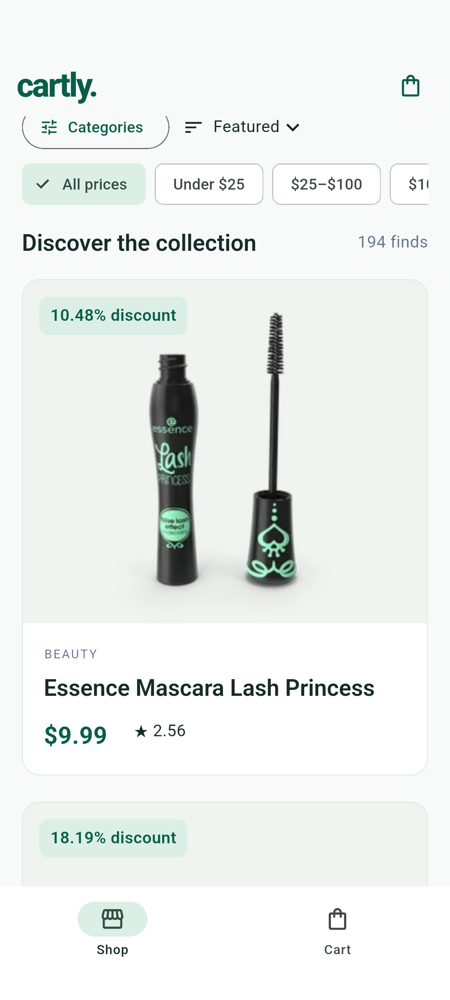

# Cartly

**Everyday, elevated.** Cartly is a mobile-first Flutter e-commerce demonstration with real sample product data, an editorial single-column catalogue, and a complete simulated shopping flow.

Cartly is an independent educational portfolio project inspired by research into publicly described e-commerce education, product discovery and customer experience concepts. It is not affiliated with, endorsed by, or an official application of Digi Skale or any other commercial organisation.

## Features

- Material 3, light-only emerald and off-white design, spacious product imagery and responsive layouts.
- DummyJSON REST integration with typed parsing, 15-second request timeouts, recoverable errors and image fallbacks.
- Default catalogue pagination in batches of 20, duplicate prevention, infinite scrolling, a Load more alternative and pagination Retry.
- Debounced case-insensitive search across titles and descriptions, multiple categories, non-overlapping price bands and four sorting options.
- Complete-dataset filtering and sorting, cached in memory for the session; matching items progressively appear in groups of 20.
- Product detail requests, swipeable image galleries, numeric ratings, API discount percentages, availability and expandable shipping/returns information.
- Application-level Provider cart with total-quantity badges, merged product rows, validated editable quantities, plus/minus controls and confirmed removal.
- Integer-cent money calculations, an illustrative order summary and a demo success route.
- Loading, no-results, empty cart, connection failure and retry states; labelled icon actions and scalable text.
- Automated unit and widget tests using injected fakes and mock HTTP clients. Tests do not use the live API.

## Screenshots

Actual Android emulator capture (API product content can change):



| Additional view | Android emulator capture |
| --- | --- |
| Product details and expandable metadata | [View screenshot](docs/screenshots/product-details.png) |
| Shopping cart and illustrative summary | [View screenshot](docs/screenshots/cart.png) |
| Demo checkout success | [View screenshot](docs/screenshots/demo-success.png) |
| Recoverable API error | [View screenshot](docs/screenshots/api-error.png) |

## Technology

Built with Flutter 3.47.7 stable and Dart 3.13.5, sound null safety, Material 3 and Flutter Navigator with MaterialPageRoute. Only two runtime packages are added: [`http`](https://pub.dev/packages/http) for REST requests and [`provider`](https://pub.dev/packages/provider) for the shared cart. Dependency resolution is recorded in `pubspec.lock`. Development tooling uses `flutter_test` and `flutter_lints`.

No authentication, database, backend service, real payment integration or third-party UI framework is needed.

## Architecture

The architecture follows responsibilities rather than a large application framework. Immutable models describe product and cart values. `ProductService` owns HTTP requests and the session dataset cache. `CatalogueController` is a screen-owned ChangeNotifier that coordinates pages, filtering and stale-response protection; it is directly unit-testable. `CartProvider` is the single application-level ChangeNotifier registered above MaterialApp.

`ShopShell` keeps Shop and Cart in an IndexedStack, preserving catalogue text, filters and scroll position across tab changes. Details and success use ordinary Navigator routes. A central page transition builder adds a short horizontal slide and fade. Reusable widgets handle product cards, images, cart rows, badges and status messages. The badge selects only the quantity count from cart state.

```text
lib/
  main.dart                         # Entry point
  app.dart                          # Provider, MaterialApp, two-tab shell
  models/
    product.dart                    # Product, category parsing and availability
    product_page.dart               # API page envelope
    cart_item.dart                   # Immutable cart row
  services/product_service.dart     # HTTP, timeout, errors, dataset cache
  providers/
    cart_provider.dart              # Shared cart and integer-cent totals
    catalogue_controller.dart       # Screen-owned catalogue state
  screens/
    catalogue_screen.dart
    product_detail_screen.dart
    cart_screen.dart
    order_success_screen.dart
  widgets/
    product_card.dart
    product_image.dart
    cart_item_tile.dart
    cart_shortcut.dart
    status_panel.dart
  theme/app_theme.dart              # Colours, typography, controls, transitions
  utils/
    currency_formatter.dart
    product_filters.dart            # Pure filtering/sorting functions
```

## API integration and querying

Data and imagery come from the [DummyJSON Products API](https://dummyjson.com/docs/products). The application calls:

- `GET /products?limit=20&skip=N` for the unfiltered catalogue.
- `GET /products/categories` for category slugs and human-readable names.
- `GET /products/{id}` when opening a detail route.
- `GET /products?limit=0&skip=0` once a search, sort or filter needs global results.

Global queries use the complete dataset, never just the first page. Search, category and price groups combine with AND; categories within the category group use OR. Sorting happens before progressive display. The service shares an in-flight full-dataset request and caches its successful result. A failed request is retryable. Catalogue generation tokens prevent old asynchronous responses from replacing newer selections, and in-flight page requests are shared by offset.

This is a deliberate small-dataset MVP tradeoff. A production catalogue would usually query, filter and sort on the server, with query-specific pagination and a more complete cache policy. The app does not call API order or payment endpoints or fabricate catalogue products.

## Setup and run

Install Flutter stable compatible with the Dart SDK constraint, configure the Android SDK and start an Android emulator. In the existing repository directory:

```powershell
flutter pub get
flutter devices
flutter run -d emulator-5554
```

Alternatively, select an Android device in VS Code and press F5. Internet access is required for products and images. The Android main manifest includes INTERNET permission so network access also works outside debug builds. Existing Gradle configuration is preserved.

## Testing and code quality

```powershell
dart format lib test
flutter analyze
flutter test
flutter test --coverage
```

Tests cover safe JSON and numeric parsing; cart addition, merging, quantity validation, removal and clearing; line and order totals; search, categories, price boundaries and all sorts; HTTP errors and cache retry; pagination and stale responses; loading, Retry, product cards, empty cart, quantity edits/removal, tab preservation, details add-to-cart and demo checkout.

The verified suite contains 71 unit and widget tests. `flutter test --coverage` reports 90.4% line coverage across measured application files and 99.1% across models, providers, services and utilities. The LCOV report is generated at `coverage/lcov.info` (ignored by Git). Line coverage measures executed lines; it does not replace the device, connectivity and TalkBack checks below.

Regression tests also verify that checkout and quantity buttons commit pending keyboard edits before calculating totals, that quantity fields remain synchronised, that hexadecimal input is rejected, and that invalid optional stock/rating data remains unknown. Async tests cover actual request timeout, retry after failure, stale errors, filter resets and disposal during loading. All HTTP responses are controlled locally in these tests.

Widget tests use products without network images and injected FakeProductService instances. Service tests use `http` MockClient. No live network requests are required.

For the separate Android device integration test, start the configured emulator and run:

```powershell
flutter emulators --launch Pixel_8
flutter drive --driver=test_driver/integration_test.dart --target=integration_test/cartly_test.dart -d emulator-5554
```

This test uses Flutter's SDK `integration_test` development dependency and the real DummyJSON API. It exercises initial/category recovery, server pagination and retry, combined global discovery, tab preservation, detail galleries and expandable metadata, cart editing and simulated checkout. Connection failures are injected at the HTTP transport boundary; recovery uses real network responses. Device screenshots are saved under `docs/screenshots/` and the machine-readable result under `build/integration_response_data.json`. This device suite requires connectivity and is kept separate from `flutter test`.

The Pixel 8 / Android 16 emulator pass and its verification limits are recorded in [the device test report](docs/device-test-report.md).

## Important design decisions

- **Money:** API unit prices round to integer USD cents first. Merchandise subtotal is the sum of unit cents times quantity. Demo tax is 10% of that subtotal rounded once to the nearest cent. Delivery is 499 cents for a nonempty cart; all empty-cart totals are zero. Display always uses two decimal places.
- **Price boundaries:** Under $25 means `[0,25)`, $25-$100 means `[25,100)`, $100-$500 means `[100,500)`, and $500 and above means `[500,infinity)`. Upper bounds are exclusive; no product falls into two bands.
- **Discounts:** A valid API percentage is displayed as metadata. The API price is shown unchanged; no invented original/list price or crossed-out value is presented, and the percentage is not applied a second time.
- **Availability:** Explicit out-of-stock API status or nonpositive stock disables adding. Low-stock API status is honoured; otherwise five units or fewer is the low-stock threshold. Missing availability stays unknown. Sample stock is not live inventory and does not impose a claimed live purchase limit.
- **Quantities:** Valid whole quantities are 1-9,999, an application input guard rather than an inventory claim. Invalid input restores the current quantity with a validation message. Buttons and field edits share CartProvider validation. Minus stops at one; removing an item requires confirmation.
- **Navigation:** Details retain the catalogue beneath the route; adding stays on details. The detail cart shortcut returns to the shell Cart tab. Checkout snapshots the illustrative count/total and clears the cart immediately after pushing success. Back returns to the empty Cart tab; Continue Shopping selects Shop.
- **Session lifetime:** Cart and catalogue caches live in memory only and reset on restart. No persistence, offline cache or background synchronisation is promised.

## Demo checkout disclaimer

**No real order is placed and no payment is processed.** Tax and delivery are illustrative demonstration amounts, not actual rates or quotes. Checkout collects no payment information or delivery address, sends no order request, and manages no real inventory.

## Manual review checklist

1. Launch Shop, wait for real images, scroll through more than 20 products and open a detail page. Swipe its gallery where multiple source images exist and expand shipping/returns.
2. Add the same item twice. Confirm the page stays open and the cart badge shows two. Open Cart using the shortcut; verify one row with quantity two.
3. Use plus/minus and edit the quantity with valid and invalid text. Confirm the line subtotal and summary update; confirm removal can be cancelled.
4. Search for a product, choose multiple categories and a price chip, then sort. Confirm all groups combine, clear search, try a no-results term and Reset Filters.
5. Switch between Shop and Cart and confirm search/filter and scroll context remain. Test Android back from details.
6. Check out from a nonempty cart. Verify the disclaimer, the cleared cart, and Continue Shopping. No external payment or order action should occur.
7. Disable the emulator connection before a new request, confirm a friendly error, restore connectivity and Retry. Later-page errors should retain earlier products. Cached query results may remain available within the current session.
8. Review on a narrow phone, with a larger system font and with the quantity keyboard open; check labelled icon actions with TalkBack.

## Limitations and future improvements

This MVP uses a public sample API and depends on its uptime, content and remote images. Full-data local querying suits this small demonstration, not a large production store. There is no persistent cart, offline mode, authentication, favourites, live inventory, real orders or payments. Android is the primary runtime target; other Flutter platforms need their own device and accessibility review. TalkBack and physical-device behaviour still need manual review. Production server queries, broader device integration coverage, localisation and persistent cart storage are possible next steps.
